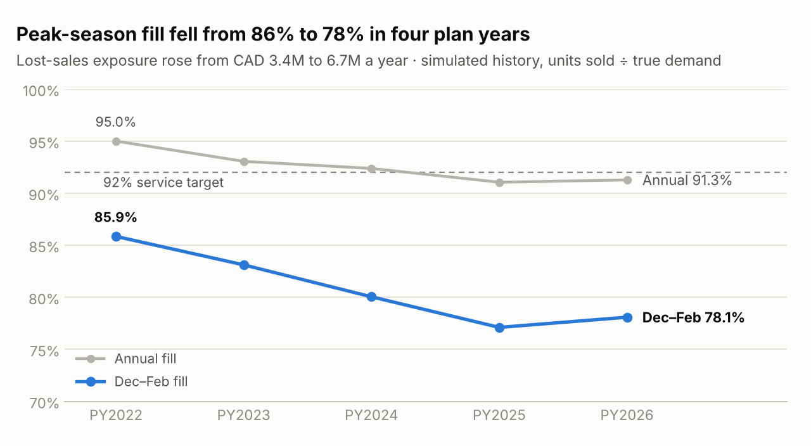
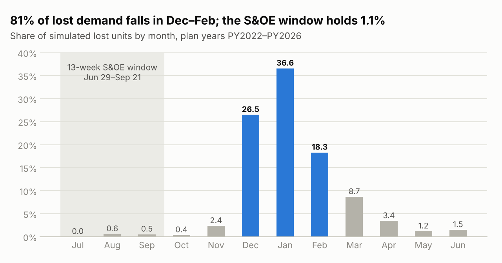
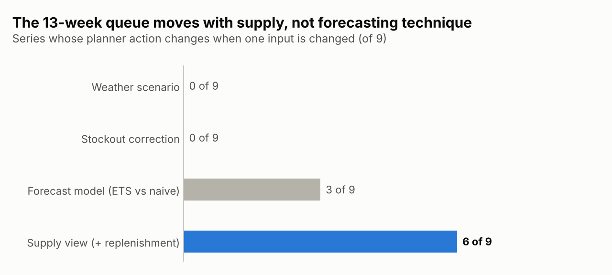

# DemandIQ · Step 8 · Peak-Season Decisions

> **Simulation notice.** Portfolio simulation; no real company data. Figures marked *simulation truth* use generator-only columns to size the problem. Everything a planner would act on comes from observable data (sales, in-stock days, receipts, buys) and reconstructed demand. Reproduce every number with `python 04_scripts/step8/step8_peak_diagnosis.py`.

## The decision

**Plan next season's Dec–Feb peak on reconstructed demand, not last year's sales.** Put about 10,000 more units into the peak: roughly 4,100 new units, plus 5,900 moved forward from spring replenishment into the October and November drops. Size chase from the same gap, and commit it by late September.

## Why

- **The peak is failing and getting worse.** Dec–Feb fill fell from 85.9% to 78.1% between PY2022 and PY2026. Annual fill (91.3%) is now below the 92% target. *(simulation truth)*
- **It is where the money is.** Lost revenue reached CAD 6.65M in PY2026, 9.1% of net revenue, and 83% of lost units fall in Dec–Feb. *(simulation truth; an upper bound, because no substitution is assumed)*
- **The buy plans the business down.** Each buy starts from last year's sales. In PY2026 those sales sat 9.0% below last year's reconstructed demand. The peak months are the most stockout-suppressed: Dec–Feb reconstructed demand was 21.0% above sales.
- **Most of the loss is timing.** For 59% of lost units, the stock did arrive within the plan year, but after the stockouts. *(simulation truth)*
- **Chase is aimed at the wrong signal.** It fires early (median plan week 11.5, mid-September) at almost the same rate whatever the eventual loss: 75% of the lowest-loss cell-years versus 77% of the highest-loss ones. It also orders almost the same amount: 93 versus 119 units per cell-year, while the highest-loss cells lose 328 units each. Early shipments can't tell which cells will run out (shipped-to-plan ratio 0.97 vs 1.02), and 5,403 units of chase capacity went unused in PY2026.

## Decision table

| # | Decision | Quantity | Decide by · owner | Guardrail | Confidence |
| --- | --- | --- | --- | --- | --- |
| 1 | Plan the Dec–Feb peak on reconstructed demand | +10,017 units across 8 series: 4,088 new, 5,930 moved forward from spring replenishment; CTS-001 ECOM held | Seasonal buy review, 22+ weeks before the October drop · planner proposes, S&OP approves, supply planning confirms | Season-end cover ≤ 8 weeks; over-buy exposure (CAD 1.09M in PY2026) must grow less than the lost revenue recovered | High on direction. Medium on size: reconstruction recovered 75% of the true gap, so +21% is conservative |
| 2 | Size and commit chase from the peak gap, not from early shipments | Up to 5,403 units (last year's unused capacity), top 20 cells first | Plan week 12 (late September), so a 10-week chase lands by December · planner with supply planning | Chase ≤ 8% of commitment | Medium: an upper bound until re-simulated |
| 3 | Focus planner attention on the top 20 of 81 SKU × region × channel cells | 60% of lost revenue; US Northeast alone 26% | Each monthly S&OP · Demand Planner | – | High: the observable stockout-days ranking matches (rank correlation 0.90; 15 of the top 20) |
| 4 | Replace the summer escalation list | 0 ESCALATE, 1 WATCH, 5 PROTECT, 3 no action (published: 3 ESCALATE). The WATCH is APS-001 Wholesale, short only if demand runs 18% above forecast | Weekly S&OE · planner decides, supply confirms in-transit replenishment | Re-check weekly as replenishment confirms | Medium: assumes last year's replenishment pattern repeats |
| 5 | Launch reserve-release rule | Hold the 991-unit reserve (12% of the 8,259-unit buy) centrally; release it to any channel running 5+ pp above planned mix at W1–W2 | Launch checkpoints W1–W2 · planner with merchants | Total launch inventory unchanged | Medium: one seeded launch. The rule fires at W1 (ECOM +5.4 pp) and could cover the 159-unit ECOM shortfall |

## Peak buy by series, next season (Dec–Feb)

| Priority | Series | Dec–Feb sales, PY2026 | Reconstructed demand | Gap | Change, units | New | Moved forward | Lost revenue, PY2026 | Over-buy exposure | Call |
| ---: | --- | ---: | ---: | ---: | ---: | ---: | ---: | ---: | ---: | --- |
| 1 | IMH-001 ECOM | 10,815 | 13,026 | +20.4% | 2,355 | 567 | 1,788 | CAD 1.23M | CAD 158K | Re-time |
| 2 | APS-001 ECOM | 4,298 | 5,221 | +21.5% | 960 | 331 | 629 | CAD 1.05M | CAD 139K | Buy more and re-time |
| 3 | APS-001 Retail | 2,899 | 3,820 | +31.8% | 958 | 628 | 330 | CAD 974K | CAD 87K | Buy more and re-time |
| 4 | IMH-001 Retail | 8,274 | 9,775 | +18.1% | 1,599 | 707 | 892 | CAD 796K | CAD 136K | Buy more and re-time |
| 5 | IMH-001 Wholesale | 5,105 | 7,445 | +45.8% | 2,491 | 1,197 | 1,294 | CAD 784K | CAD 47K | Buy more and re-time |
| 6 | CTS-001 Retail | 3,815 | 4,406 | +15.5% | 623 | 60 | 563 | CAD 575K | CAD 146K | Re-time |
| 7 | APS-001 Wholesale | 2,447 | 3,111 | +27.2% | 691 | 505 | 186 | CAD 562K | CAD 44K | Buy more and re-time |
| 8 | CTS-001 Wholesale | 2,870 | 3,192 | +11.2% | 340 | 91 | 249 | CAD 390K | CAD 71K | Buy more and re-time |
| 9 | CTS-001 ECOM | 5,946 | 6,248 | +5.1% | 319 | 172 | 147 | CAD 283K | CAD 264K | Hold |

How the calls are made:

- **Change** = (reconstructed − sold) Dec–Feb demand × (1 + SKU growth).
- **New vs moved forward** follows each series' quantity/timing split. *(simulation truth)*
- **Hold** when over-buy exposure is already at least 50% of lost revenue.
- **Re-time** when less than 25% of the change needs new units.

## What this does not settle

- **The data is simulated, and the failure modes were designed in.** The assumptions register says so for the peak throttle and the shipment-based chase. The test is that this diagnosis finds them from observable data. The size of every effect is still a property of the simulation.
- **Some inputs are simulation truth.** That covers the quantity/timing split, lost revenue and over-buy exposure. A real planner would estimate them from row-level reconstructed demand. That Step 4A output isn't committed yet, so the buy is set at SKU × channel, not by region.
- **Lost revenue is an upper bound.** It assumes no substitution to other styles, channels or weeks.
- **Supply constraints aren't modelled.** Supplier capacity, minimum order quantities and PO-change windows are missing, so supply planning must confirm the 4,088 new units.

## Files

- Script: `04_scripts/step8/step8_peak_diagnosis.py` (reads committed files only; about 3 seconds)
- Outputs: `05_outputs/peak_season_diagnosis/`. Thirteen CSVs; `DemandIQ_Step8_Headline_Metrics.csv` holds every number on this page, with its basis.
- Charts: `08_assets/charts/step8_*.png`
