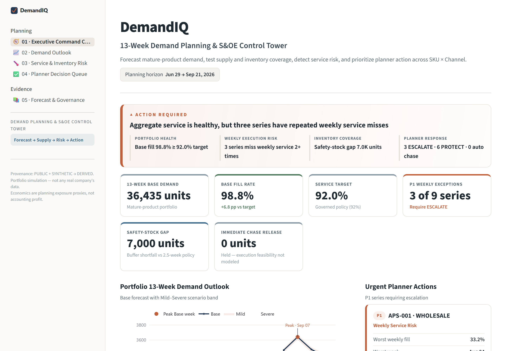
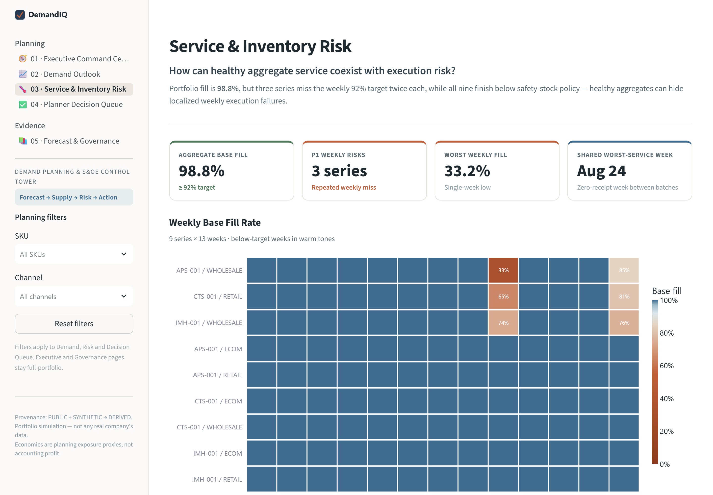
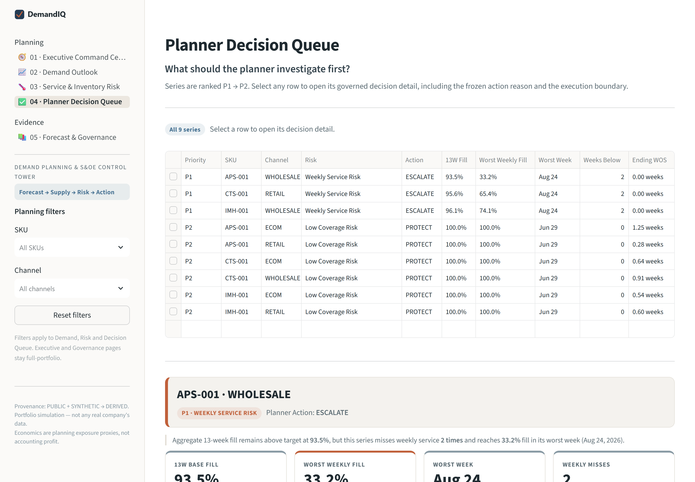

> **Technical appendix.** This is the original DemandIQ README, kept for the method detail. Start with the [README](../README.md) and the [Step 8 decision page](./DemandIQ_Step8_Peak_Season_Decisions.md). The 13-week escalation list shown here (3 ESCALATE, 6 PROTECT) is the v1 plan, which counted only the seasonal drops as supply. Step 5 now also adds an estimate of 6,512 replenishment units (last year's receipts shifted 52 weeks, not confirmed open orders). If that estimate arrives as modelled it escalates none: 0 ESCALATE, 7 PROTECT, 2 HOLD, and Step 8's error-band check agrees on 7 of 9 series. The published list stands until a planner confirms open-order quantities and receipt dates. Both views use seasonal drops projected from last year's receipts (column `committed_receipt_units`, a v1 name kept for compatibility), not confirmed supplier orders. The v1 outputs are kept in `05_outputs/v1_published_plan/`, and the app screenshots below show v1.

# DemandIQ

## Demand Planning, IBP & New Product Launch Decision System for Premium Outdoor Apparel

DemandIQ is a portfolio simulation that connects forecasting to planning decisions across mature products, inventory and service risk, S&OE escalation, and new-product launch planning.

> **Risk detection is not execution authorization.**
>
> DemandIQ surfaces where planner attention is required, but it does not automatically release chase, transfer, or reallocation actions when supplier lead time, PO-change windows, transfer feasibility, or execution cost are not fully modeled.

> **Data note:** This project uses public, synthetic, and derived data. No real company internal planning data was used. Economic values are planning exposure proxies, not accounting profit.

---

## Start Here

- **Case study:** [`06_docs/DemandIQ_Final_Portfolio_Case_Study.pdf`](../06_docs/DemandIQ_Final_Portfolio_Case_Study.pdf)
- **Streamlit application source:** [`07_streamlit_app/`](../07_streamlit_app/)
- **Model evidence:** [`03_model_evidence/`](../03_model_evidence/)
- **Analytical pipeline:** [`04_scripts/`](../04_scripts/)
- **Decision outputs:** [`05_outputs/`](../05_outputs/)
- **Planning documentation:** [`06_docs/`](../06_docs/)

### Application preview

**Executive Command Center**



**Service & Inventory Risk**



**Planner Decision Queue**



---

## Project at a glance

DemandIQ addresses two related planning problems:

1. **Mature-product planning:** recover demand hidden by stockouts, select defensible forecasts, test bounded weather scenarios, evaluate inventory and service risk, and prioritize planner actions.
2. **New-product planning:** forecast a product with no sales history, reconcile analytical and commercial views, set the initial buy, learn from launch sell-through, measure Forecast Value Add, and roll the plan forward.

### Products

| SKU | Product | Status |
|---|---|---|
| **APS-001** | Alpine Performance Shell | Mature |
| **CTS-001** | Core Technical Shell | Mature |
| **IMH-001** | Insulated Midlayer Hoody | Mature |
| **HIS-001** | Hybrid Insulated Shell | Early launch |

### Channels

- **ECOM:** direct online
- **RETAIL:** company-operated stores
- **WHOLESALE:** partner / wholesale channel

### Planning horizons

- **13 weeks, weekly:** S&OE execution and launch monitoring
- **18 months, monthly:** IBP, consensus planning, and rolling forecast

---

## Key outcomes

### Mature-product engine

| Metric | Result |
|---|---:|
| Base 13-week demand | **36,434.66 units** |
| Portfolio Base fill | **98.77%** |
| Service target | **92%** |
| P1 weekly-service risks | **3 of 9 series** |
| Planner queue | **3 ESCALATE · 6 PROTECT** |
| Automatic chase / reallocation | **0 units** |
| Base unserved-demand revenue exposure | **≈ CAD 192K** |

### New-product engine

| Metric | Result |
|---|---:|
| V0 13-week cold-start demand | **≈ 6,888 units** |
| V3 approved 13-week demand | **≈ 7,577 units** |
| Frozen initial buy | **≈ 8,259 units** |
| Flex reserve | **≈ 991 units** |
| Observed launch sales | **≈ 6,650 units** |
| Launch fill | **≈ 97.7%** |
| Cycle-02 like-for-like revision | **≈ -3.05%** |
| Current lifecycle | **EARLY_LAUNCH** |

---

# Mature Product Planning

## 1. Recover demand before forecasting

Observed sales can understate demand when inventory is unavailable. I compared three reconstruction approaches and selected **Seasonal Profile Imputation** for stockout-censored rows.

| Reconstruction metric | Result |
|---|---:|
| Censored-row WAPE | **26.08%** |
| Bias | **-2.61%** |
| Lost-demand recovery | **95.68%** |
| Full-stockout recovery | **98.43%** |

The governed forecast target is `reconstructed_demand_units`.

A hidden synthetic demand series is used only to evaluate reconstruction quality. It is never used as a forecast feature.

---

## 2. Backtest at the planning grain

The governed mature forecasting grain is:

**Week × SKU × Channel**

That produces **9 forecast series** across 3 products and 3 channels.

Each series uses the same backtest design:

- 52-week seasonality
- 104-week initial training window
- 13-week forecast horizon
- 12 expanding-window folds
- WAPE as the primary metric
- Bias monitored separately

### Final champion mix

- **8 ETS models**
- **1 Seasonal 2-Year Moving Average baseline**
- **0 SARIMA champions**

Champion WAPE ranges from approximately **8.4% to 21.7%**.

A simpler baseline was retained when added complexity did not produce a meaningful improvement.

---

## 3. Use weather as a bounded planning scenario

Weather is treated as a planning overlay, not as future leakage.

- **Weeks 1 to 3:** `NOWCAST_REQUIRED` unless a real point-in-time nowcast is available
- **Weeks 4 to 13:** Mild / Normal / Severe seasonal scenarios
- Realized future weather is never used

| Scenario | 13-week demand |
|---|---:|
| Mild | **≈ 36,036 units** |
| Base | **36,434.66 units** |
| Severe | **≈ 36,677 units** |

The scenario range is narrow relative to supply and inventory timing risk in the same horizon.

---

## 4. Surface weekly service risk, not only portfolio fill

The portfolio Base fill rate is **98.77%** against a **92%** target. That looks healthy at first, but weekly execution shows something different.

| SKU | Channel | 13W Fill | Worst Weekly Fill | Action |
|---|---|---:|---:|---|
| APS-001 | WHOLESALE | 93.5% | **33.2%** | **ESCALATE** |
| CTS-001 | RETAIL | 95.6% | **65.4%** | **ESCALATE** |
| IMH-001 | WHOLESALE | 96.1% | **74.1%** | **ESCALATE** |

All three share a worst week of **2026-08-24**, when projected seasonal receipts are zero across all nine mature series (v1 view, zero replenishment).

That timing coincides with localized service failures, but I do **not** treat it as proven causation.

---

## 5. Separate risk detection from execution authorization

The final mature decision queue is:

- **3 P1:** ESCALATE
- **6 P2:** PROTECT

All nine series also finish below the 2.5-week coverage policy.

The approximately **7,000-unit gap to coverage policy** is a diagnostic planning signal, not an automatic buy recommendation.

DemandIQ does not automatically release chase, transfer, or reallocation because supplier lead times, expedite feasibility, PO-change windows, and transfer feasibility are not fully modeled.

The output is therefore a planner review queue rather than a false-precision recommendation.

---

# New Product Launch Planning

## 6. Forecast a product without its own sales history

**HIS-001, Hybrid Insulated Shell** is modeled as a cold-start product.

The final governed analog blend is:

- **60% APS-001**
- **40% IMH-001**

### V0 analytical baseline

| Horizon | V0 demand |
|---|---:|
| 13 weeks | **≈ 6,888 units** |
| First 12 months | **≈ 27,480 units** |
| 18 months | **≈ 44,919 units** |

---

## 7. Move from analytical forecast to approved consensus

The launch process uses four forecast versions:

| Version | Meaning |
|---|---|
| **V0** | Analytical forecast |
| **V1** | Commercial forecast |
| **V2** | Consensus forecast |
| **V3** | Approved forecast |

| Version | First 12 months | 18 months |
|---|---:|---:|
| V0 | **≈ 27,480** | **≈ 44,919** |
| V1 | **≈ 30,476** | **≈ 49,816** |
| V3 | **≈ 30,228** | **≈ 49,411** |

**V3 remains an approved unconstrained demand plan.** It is not a supply-constrained forecast.

---

## 8. Turn the approved forecast into an initial buy

| Buy component | Units |
|---|---:|
| V3 approved 13-week demand | **≈ 7,577** |
| Launch uncertainty buffer | **9%** |
| Frozen initial buy | **≈ 8,259** |
| Flex reserve | **≈ 991** |

### Initial channel allocation

| Channel | Units |
|---|---:|
| ECOM | **≈ 3,271** |
| RETAIL | **≈ 2,544** |
| WHOLESALE | **≈ 1,454** |
| Flex reserve | **≈ 991** |

Supply assumptions such as lead time and chase capacity are synthetic planning assumptions used to demonstrate the workflow.

---

## 9. Let launch evidence change the plan

The launch path is a **synthetic seeded simulation** used to demonstrate the planning loop.

| Launch outcome | Result |
|---|---:|
| Observed sales | **≈ 6,650 units** |
| Evaluation-only latent demand | **≈ 6,809 units** |
| Launch fill | **≈ 97.7%** |

### Reforecast progression

| Checkpoint | Reforecast |
|---|---:|
| Original V3 | **7,577** |
| W1 | **7,465** |
| W2 | **7,310** |
| W4 | **7,030** |
| W8 | **6,943** |
| W13 | **6,650** |

As launch evidence accumulates, actual performance receives more weight and the analog prior receives less.

Every frozen checkpoint remained **HOLD**. The planning rules did not force a chase, cut, or reallocation.

---

## 10. Measure Forecast Value Add

FVA asks:

**Did each planning intervention improve forecast accuracy?**

| Version | WAPE |
|---|---:|
| V0 Analytical | **5.66%** |
| V1 Commercial | **12.58%** |
| V2 Consensus | **11.81%** |
| V3 Approved | **11.81%** |

| Transition | FVA |
|---|---:|
| V0 to V1 | **-6.92 pp** |
| V1 to V2 | **+0.77 pp** |
| V2 to V3 | **0.00 pp** |

> **Important caveat:** the synthetic launch generator was centered on the V0 analytical baseline. V0 outperforming later versions on this seeded path is therefore an illustrative governance result, not independent evidence that commercial input is harmful.

---

## 11. Capture channel-allocation learning

Observed ECOM mix finished around **49.2%** versus the planned **45%**.

At the same time:

- ECOM lost demand was approximately **159 units**
- flex reserve remained approximately **991 units**
- the historical reallocation trigger was **8 percentage points**

This surfaced an important distinction:

> **Total supply sufficiency and channel allocation are different problems.**

Inventory remained available while ECOM stocked out. The project therefore surfaced a channel-allocation and policy-timing issue.

The later threshold analysis is counterfactual. It does not claim that another threshold is optimal.

---

## 12. Roll the forecast forward

### Cycle 01

- As of **2026-08-24**
- Forecast window: **Sep 2026 to Feb 2028**

### Cycle 02

- As of **2026-09-28**
- Uses only the first four weeks of launch evidence
- Forecast window: **Oct 2026 to Mar 2028**
- September becomes actualized
- March 2028 becomes the new far-horizon month

Across the **17 like-for-like overlapping months**, Cycle 02 is approximately **3.05% lower** than Cycle 01.

---

## 13. Hand off the product through its lifecycle

| Lifecycle stage | History |
|---|---|
| COLD_START | 0 weeks |
| **EARLY_LAUNCH** | **1 to 13 weeks** |
| MATURING_LAUNCH | 14 to 51 weeks |
| SEASONAL_HISTORY_AVAILABLE | 52+ clean weeks |
| MATURE_MODEL_ELIGIBLE | 104+ clean weeks plus data-quality gates |

Current status: **EARLY_LAUNCH**

Current forecasting method: **Analog + actual-evidence blend**

No ETS or SARIMA model is fitted to HIS-001 yet.

---

# Streamlit Decision Product

DemandIQ is implemented as a six-page planning workspace:

1. **Executive Command Center**
2. **Demand Outlook**
3. **Service & Inventory Risk**
4. **Planner Decision Queue**
5. **Forecast & Governance**
6. **New Product Launch Planning**

The launch page connects:

```text
Analog selection
→ Cold-start V0
→ V1 / V2 / V3 consensus
→ Initial buy
→ Launch execution
→ Reforecast
→ FVA
→ Cycle 02
→ Lifecycle handoff
```

---

# Data and Governance

| Class | Examples |
|---|---|
| **PUBLIC** | Historical weather observations |
| **SYNTHETIC** | Demand truth, inventory constraints, planning policies, supply assumptions, launch actuals |
| **DERIVED** | Reconstructed demand, forecasts, WAPE, Bias, FVA, fill rate, WOS, risk tiers, rolling forecast updates |

### Explicitly excluded from mature forecast features

- `true_demand_units`
- `lost_demand_units`
- `audit_hidden_*`
- `weather_effect_pct`
- `weather_factor`
- generator-only spike, shock, and noise variables

### Launch hidden truth

The seeded launch contains a latent synthetic demand series for evaluation. It is:

- evaluation-only
- hidden from the operational planner
- excluded from operational KPIs
- excluded from reforecast decisions

---

# Limitations

- DemandIQ is a portfolio simulation, not a production planning system
- Launch actuals follow one synthetic seeded path
- Supplier constraints and execution feasibility are simplified
- Weather scenario caps are planning assumptions, not estimated causal elasticities
- Economics are planning exposure proxies, not accounting profit
- FVA is affected by the V0-centered launch simulation design
- HIS-001 has only 13 observed launch weeks and is not mature-model eligible
- No live enterprise planning-platform integration is implemented

---

# Repository Structure

```text
DemandIQ/
├── 01_assumptions/
├── 02_data/
├── 03_model_evidence/
├── 04_scripts/
├── 05_outputs/
│   ├── forecasts/
│   ├── ibp_decisions/
│   ├── decision_layer/
│   ├── launch_step7b/
│   ├── launch_step7c/
│   ├── launch_step7d/
│   ├── launch_step7e/
│   └── launch_step7f/
├── 06_docs/
│   └── DemandIQ_Final_Portfolio_Case_Study.pdf
├── 07_streamlit_app/
│   ├── app.py
│   └── requirements.txt
├── 08_assets/
│   └── screenshots/
├── DemandIQ_Case_Study.pdf
└── README.md
```

---

# Run Locally

```bash
cd 07_streamlit_app
python -m pip install -r requirements.txt
python -m streamlit run app.py
```

Then open:

`http://localhost:8501`

---

# Skills Demonstrated

**Forecasting**
- demand reconstruction
- time-series forecasting
- expanding-window backtesting
- forecast accuracy and bias
- weather scenario planning

**Demand Planning and S&OE**
- 13-week planning
- inventory and service-risk analysis
- exception management
- planner decision queues
- detection separated from execution authorization

**IBP and New Product Planning**
- 18-month rolling forecasts
- analog-led cold-start forecasting
- forecast-version governance
- consensus planning
- initial-buy planning
- channel allocation
- launch sell-through
- reforecasting
- Forecast Value Add
- lifecycle handoff

**Tools**
- Python
- pandas
- statsmodels
- Plotly
- Streamlit
- Git / GitHub

---

## Planning concepts demonstrated

DemandIQ demonstrates concepts commonly used in enterprise planning environments:

- planning hierarchies
- forecast versions
- overrides and consensus
- scenario planning
- rolling horizons
- exception management
- approval and governance workflows

This project demonstrates the planning concepts themselves. It does not claim hands-on experience with any specific commercial planning platform.

---

*Portfolio simulation using public, synthetic, and derived data. No real company internal planning data was used. Economic values are planning exposure proxies.*